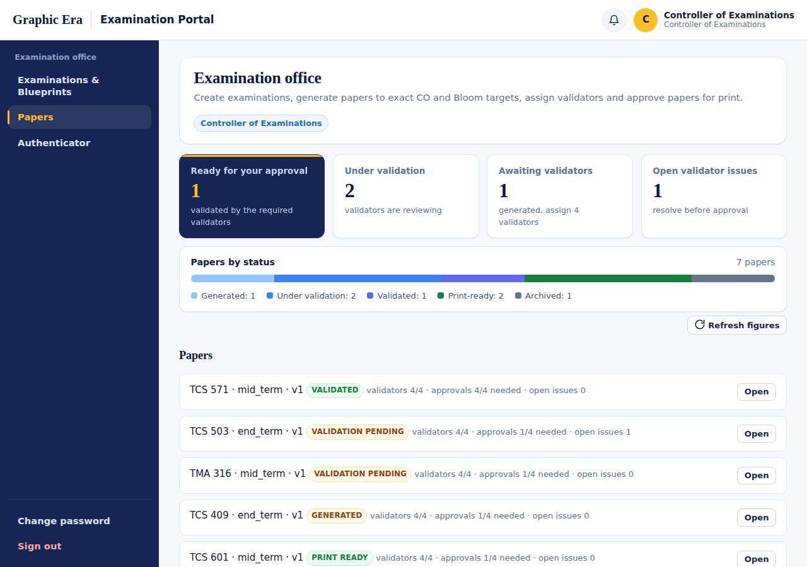
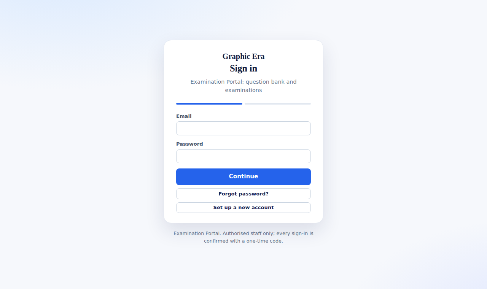
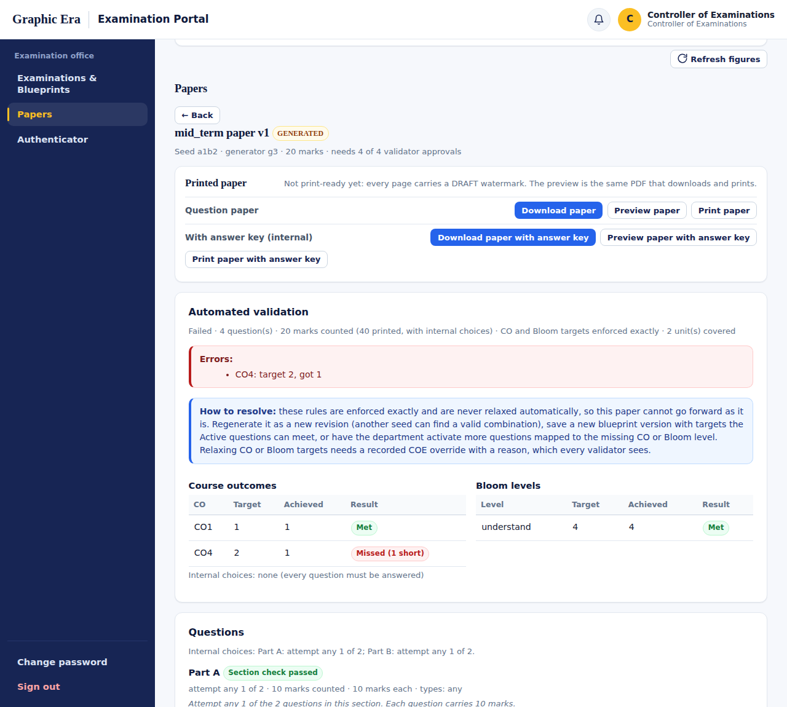
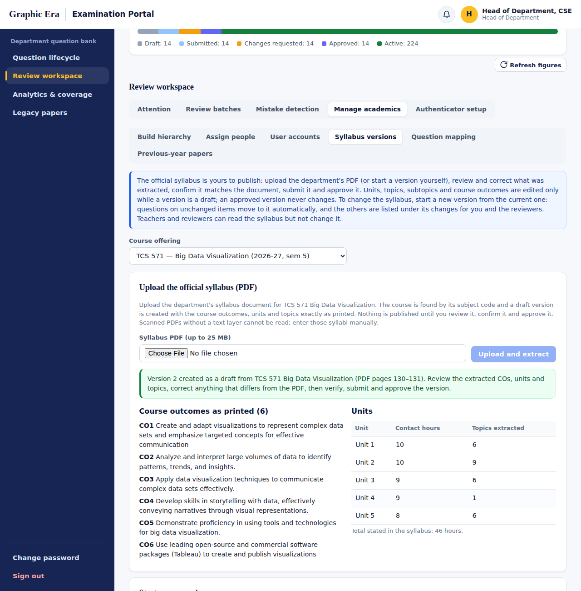
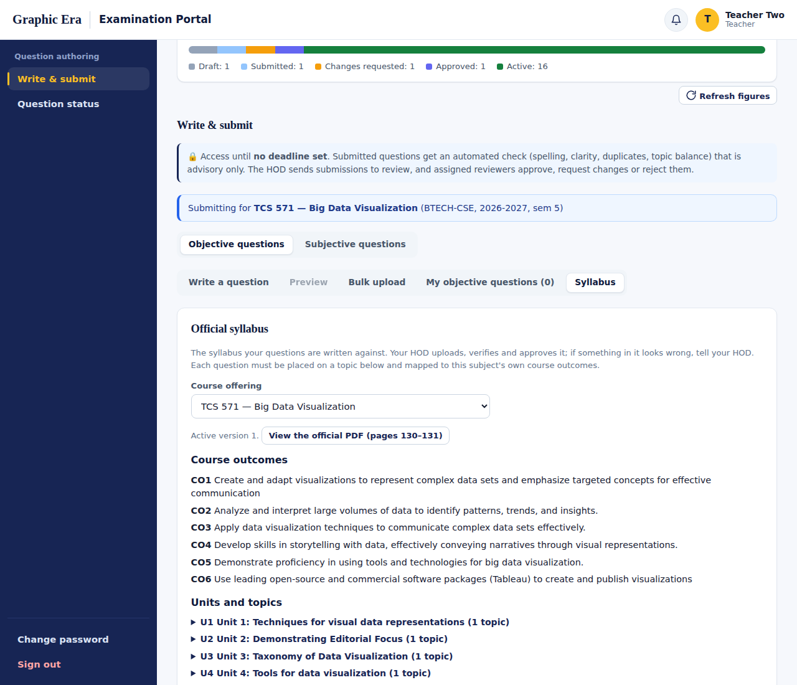
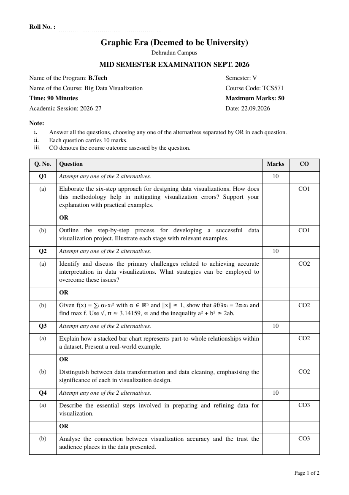

# Graphic Era Examination Portal

A secure, role-based portal that takes an examination paper from the **official syllabus** to a **printed,
approved paper**: HOD-published syllabi, a reviewed question bank mapped to course outcomes and Bloom's taxonomy,
generation that meets CO and Bloom targets exactly, independent validation by four validators, two-factor final
approval by the Controller of Examinations, and printing in the institution's formal paper format.



## Highlights

- **Official syllabus, published by the HOD.** Upload the department's syllabus PDF; course outcomes, units, contact hours
  and topics are extracted exactly as printed (with warnings for anything uncertain) into a draft the HOD verifies and
  approves. Versioned, with change detection when the syllabus changes.
- **A reviewed question bank.** 13 question types. Every question sits on a syllabus topic, maps to its own subject's
  COs, carries a Bloom level and difficulty, and passes an independent review with a checklist and a quality gate.
- **Exact paper generation.** Blueprints with difficulty counts, marks, sections, internal choice (OR), CO and Bloom
  targets. Targets are met exactly or generation is refused with the reason; overrides are explicit and visible.
- **Independent validation and approval.** Four validators with an 11-point checklist, issue tracking, then the COE's
  approval confirmed with an authenticator app. Approved papers are locked.
- **Formal printed papers.** Roll number line, examination details, numbered instructions, a bordered question table with
  marks and CO, OR alternatives, page numbers, Unicode and mathematical notation; the internal copy adds a CO / Bloom /
  unit / difficulty analysis and the answer key.
- **Security by design.** Password + one-time code sign-in, scope-based authorization on every request, separation of
  duties, workflow rules enforced in the database, tamper-evident audit log, rate limiting and upload scanning.

## Roles

| Role | Responsibilities | Guide |
|---|---|---|
| Teacher | Writes and submits questions for assigned subjects; revises returned questions | [Teacher guide](docs/user-guide/teacher.md) |
| Head of Department | Publishes the syllabus; assigns teachers and reviewers; runs review batches; monitors coverage | [HOD guide](docs/user-guide/hod.md) |
| Reviewer | Verifies classification and quality; approves or returns questions | [Reviewer guide](docs/user-guide/reviewer.md) |
| Controller of Examinations | Examinations, blueprints, generation, validators, final approval, printing | [COE guide](docs/user-guide/coe.md) |
| Paper validator | Independently checks an assigned paper and records a decision | [Validator guide](docs/user-guide/validator.md) |
| Technical administrator | Accounts, scopes, policies, platform health (no academic powers) | [Administrator guide](docs/user-guide/admin.md) |

## Quick start

Requirements: **Node.js 22+** and **Docker**. Full instructions: [Installation](docs/getting-started/installation.md).

```bash
# 1. Database
docker compose up -d

# 2. Backend (terminal 1)
cd backend
npm ci
cp .env.example .env
sed -i "s|^JWT_SECRET=.*|JWT_SECRET=$(openssl rand -hex 32)|" .env
sed -i '/^OTP_DELIVERY_PROVIDER=/d; /^DEV_OTP_CONSOLE=/d; /^RATE_LIMIT_STORE=/d' .env
printf 'OTP_DELIVERY_PROVIDER=console\nDEV_OTP_CONSOLE=reveal\nRATE_LIMIT_STORE=memory\nINSTITUTION_NAME="Graphic Era (Deemed to be University)"\n' >> .env
npm run migrate
npm run seed          # base accounts and academic structure
npm run seed:demo     # 14 subjects of the 2023 CSE syllabus + 280 sample questions
npm run dev           # http://localhost:4000 — sign-in codes are printed here

# 3. Frontend (terminal 2)
cd frontend
npm ci
npm run dev           # http://localhost:5173
```

Then follow the [45-minute guided demo](docs/getting-started/demo-walkthrough.md).

## Demo accounts

For development and demonstrations only (the passwords are public). Every sign-in also needs a one-time code, printed
in the backend terminal in development.

| Role | Email | Password |
|---|---|---|
| Administrator | `admin@portal.edu` | `Admin@12345` |
| Head of Department | `hod@portal.edu` | `Hod@12345` |
| Reviewer | `reviewer@portal.edu`, `reviewer2@portal.edu`, `reviewer3@portal.edu` | `Review@123` |
| Reviewer (other department) | `reviewer.ece@portal.edu` | `Review@123` |
| Teacher | `teacher1@portal.edu` … `teacher4@portal.edu` | `Teach@123` |
| Controller of Examinations | `coe@portal.edu` | `Coe@123456` |
| Paper validator | `validator1@portal.edu` … `validator5@portal.edu` | `Valid@12345` |

Details, assignments and the COE authenticator setup: [Demo accounts and sign-in](docs/getting-started/demo-credentials.md).

## Demo data

`npm run seed:demo` loads **14 theory subjects** of the Graphic Era 2023 CSE syllabus (semesters I–VII) with
**20 sample questions each** (280 in total, 11 question types, all six Bloom levels), built through the application's
own API as each role. The syllabus content is official; the questions are **sample content for testing**, not official
examination questions. Browse them in [docs/demo-data](docs/demo-data/README.md).

## Screenshots

| | |
|---|---|
|  |  |
| Sign-in with one-time code | A generated paper with its automated validation |
|  |  |
| HOD uploads the official syllabus PDF | Teachers read the active syllabus |

<p align="center"><br>
<em>The printed paper in the institution's format</em></p>

## Documentation

Everything is in [`docs/`](docs/README.md):

- **Getting started:** [installation](docs/getting-started/installation.md) · [demo accounts](docs/getting-started/demo-credentials.md) · [guided demo](docs/getting-started/demo-walkthrough.md)
- **User guides:** [basics](docs/user-guide/README.md) · [Teacher](docs/user-guide/teacher.md) · [HOD](docs/user-guide/hod.md) · [Reviewer](docs/user-guide/reviewer.md) · [COE](docs/user-guide/coe.md) · [Validator](docs/user-guide/validator.md) · [Administrator](docs/user-guide/admin.md)
- **Reference:** [workflows](docs/reference/workflows.md) · [question types](docs/reference/question-types.md) · [taxonomy](docs/reference/taxonomy.md) · [architecture & security](docs/reference/architecture.md) · [configuration](docs/reference/configuration.md) · [API](docs/reference/api.md) · [testing](docs/reference/testing.md) · [glossary](docs/reference/glossary.md)
- **Help:** [troubleshooting & FAQ](docs/troubleshooting.md)

## Technology

| Layer | Stack |
|---|---|
| Frontend | React 19, Vite, CSS design tokens (Graphic Era palette), Playwright browser tests |
| Backend | Node.js 22, Express, PostgreSQL 16 + pgvector, PDFKit, argon2, otplib, SheetJS |
| Operations | Docker Compose, Kubernetes manifests, GitHub Actions CI, optional Redis, ClamAV and SMTP |

## Repository structure

```
backend/       API, migrations, demo data (data/syllabus-2023), tests
frontend/      React application and browser tests
docs/          documentation, user guides, demo data pages, images
k8s/           Kubernetes manifests
.github/       CI workflow, issue and pull-request templates
docker-compose.yml, docker-compose.prod.yml, .env.prod.example, run-checks.sh
```

## Testing

```bash
cd backend && npm test                                   # unit + route tests (no database needed)
cd frontend && npm run lint && npm run build && npm run test:e2e
```

At this release: 143 unit tests, 374 route tests and 100 browser checks pass. CI also migrates a real PostgreSQL
database, runs a smoke test and the demo seed, and builds the Docker images. See [Testing](docs/reference/testing.md).

## Security

Never deploy with the demo accounts or demo data; the seed scripts refuse to run in production. Configuration for
production is described in [Configuration](docs/reference/configuration.md#production-checklist). To report a
vulnerability, see [SECURITY.md](SECURITY.md).

## Contributing and changes

See [CONTRIBUTING.md](CONTRIBUTING.md) and [CHANGELOG.md](CHANGELOG.md).

## Official assets and licensing

- The official Graphic Era logo is **not included**; the name is shown as text until an approved logo is configured
  ([Branding](docs/reference/configuration.md#branding)).
- `backend/data/syllabus-2023/Syllabus-2023-New.pdf` is the department's official syllabus document, included as the
  source of the demo data.
- No open-source license has been chosen for this repository yet; until a `LICENSE` file is added, all rights are
  reserved by the project owner. The bundled DejaVu fonts are distributed under their own license
  (`backend/assets/fonts/LICENSE-DejaVu.txt`).
