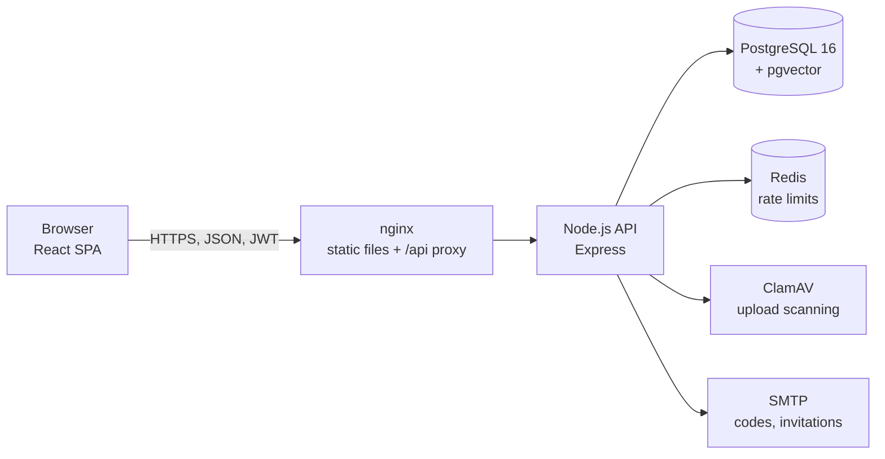
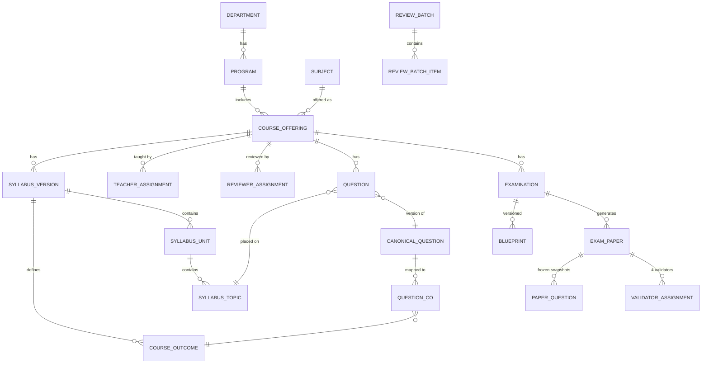

# Architecture and security

## Overview



| Layer | Technology |
|---|---|
| Frontend | React 19, Vite, plain CSS with Graphic Era design tokens; no client router (role-based workspaces) |
| API | Node.js 22, Express; helmet, CORS, rate limiting; JWT sessions with a server-side revocation counter |
| Passwords | argon2 hashes; per-account lockout after repeated failures |
| Second factor | Emailed one-time codes for sign-in; TOTP authenticator (otplib) for the COE's final approval, secrets encrypted at rest |
| Database | PostgreSQL 16 with `pgvector` (duplicate detection); 43 migrations, about 70 tables; workflow rules enforced by triggers |
| Documents | PDFKit for papers (embedded DejaVu fonts for Unicode); a built-in PDF text extractor for syllabus uploads; SheetJS (xlsx) for bulk upload and export |
| Deployment | Docker Compose (`docker-compose.prod.yml`) or Kubernetes (`k8s/`: namespace, secrets, config, PostgreSQL, ClamAV, Redis, migration job, backend, frontend, ingress) |

## Repository layout

```
backend/
  src/                 API modules
    routes/            one router per area (auth, academic, syllabus-upload, syllabus-changes, questions,
                       questions-lifecycle, review-batches, examinations, coe-approval, users, admin, ...)
    exam-generator.js  paper selection under hard constraints
    paper-pdf.js       the printed paper (formal template, Paper Analysis, answer key)
    pdf-text-extract.js, syllabus-parse.js   syllabus PDF upload
    taxonomy.js, question-types.js           shared definitions
    seed.js, seed-demo.js, demo-dataset.js   demo data
  migrations/          SQL migrations (schema, triggers, guards)
  data/syllabus-2023/  official syllabus PDF, catalog, sample questions
  assets/              fonts and brand slot for printed papers
  test/, test-*.mjs    route tests (mock database) and unit tests
frontend/
  src/                 App shell, role dashboards, components, lib
  e2e/mock-ui.cjs      browser tests against a mocked API
docs/                  this documentation
k8s/                   Kubernetes manifests
```

## Data model (main entities)



## Key design decisions

- **The database is the last line of defence.** Status transitions of syllabus versions, questions and papers, the
  question quality gate, CO validity, frozen generation metadata, and the approval prerequisites (four validators,
  required approvals, no open issues, TOTP-confirmed approval) are enforced by triggers, not only by the API.
- **Papers are frozen.** A generated paper stores snapshots of its questions, its section rules, its targets and each
  question's CO codes. Later changes to the bank never alter it; the printed PDF is always rendered from the snapshots.
- **Exact targets or a clear refusal.** The generator meets difficulty, marks, section, CO and Bloom constraints exactly,
  searching all combinations when needed; if none exists it explains why. Overrides are explicit, reasoned and visible.
- **Syllabus fidelity.** COs and unit text are stored exactly as printed; extraction warnings are surfaced to the HOD;
  nothing is invented to fill gaps.
- **Advisory automation.** Automated question checks never change a question's status; humans decide.

## Security

| Area | Measures |
|---|---|
| Authentication | Password + emailed one-time code (5-minute codes, 3 attempts); account lockout (5 failures, 15 minutes); password reset by code; invitations by setup code (no admin-set passwords) |
| Sessions | Short-lived JWTs checked against the live account (active flag, `token_version` revocation on deactivation, role change, password change) |
| Authorization | Role checks plus **scopes** (campus, department, program, offering) on every request; refusals are logged; responses do not reveal objects outside the scope |
| Separation of duties | Reviewers cannot review their own questions; admins have no academic powers; only the HOD publishes the syllabus; only validators decide on papers; COE approval needs the authenticator |
| Uploads | Content-type checked by content; size limits; files stored under generated names; diagrams quarantined until virus-scanned; syllabus PDFs parsed with decompression and object limits, encrypted PDFs refused |
| Output | Untrusted text cleaned before printing (control, zero-width and bidi-override characters); answer keys only on the internal copy |
| Platform | helmet security headers, CORS allow-list, rate limits with automatic IP blocking, tamper-evident audit log with chain verification |
| Configuration | Production refuses console code delivery, missing CORS, weak secrets and the seed scripts |
