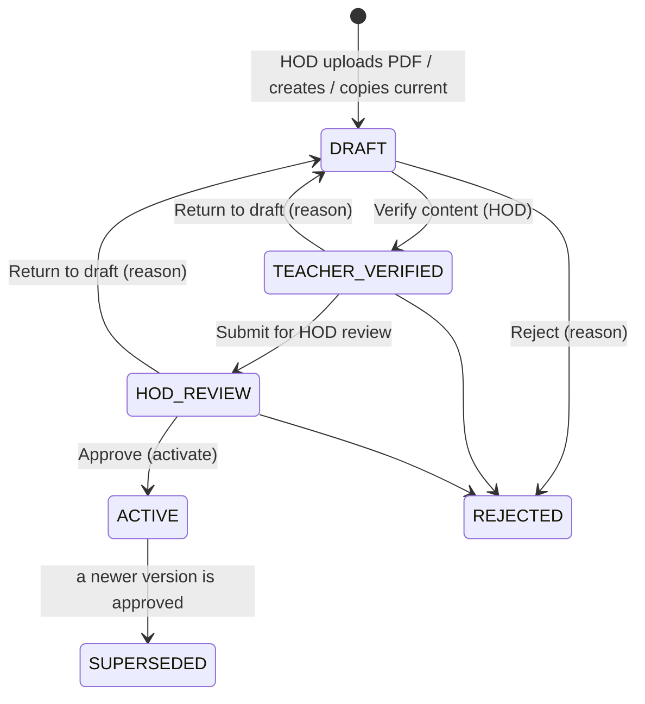
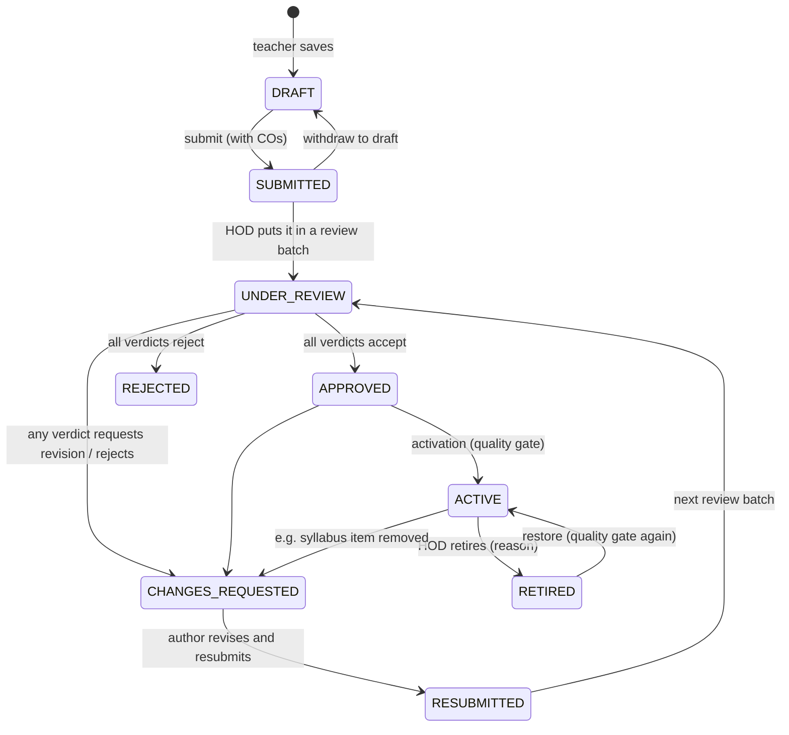
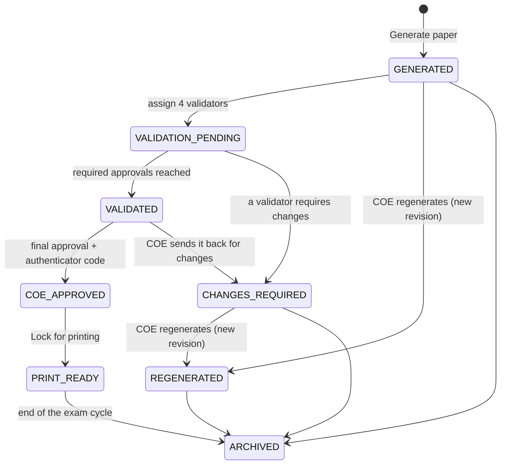

# Workflows and state machines

Every status change below is enforced twice: by the API route (role, scope, preconditions) and by the database (a
trigger refuses any transition not in these diagrams). Every change is audited.

## End-to-end flow

```mermaid
flowchart LR
  A[HOD uploads / enters syllabus] --> B[HOD verifies, submits, approves<br/>syllabus version ACTIVE]
  B --> C[HOD assigns teachers and reviewers]
  C --> D[Teachers write questions<br/>on syllabus topics, with COs]
  D --> E[HOD creates review batch]
  E --> F[Reviewers verify and decide]
  F -->|changes requested| D
  F -->|approved| G[Activation<br/>quality gate]
  G --> H[(Active question bank)]
  H --> I[COE: examination + blueprint<br/>generate paper]
  I --> J[4 validators decide]
  J -->|changes required| I
  J -->|approved| K[COE final approval<br/>with authenticator]
  K --> L[Lock for printing<br/>PRINT_READY]
```

## Syllabus version

- Shown in the interface as *Draft → Content verified → In HOD review → Active*. (`TEACHER_VERIFIED` is the stored name
  from before syllabus publishing became HOD-only.)
- Content (COs, units, topics, subtopics) can change only in **DRAFT**. Verification and approval require at least one
  CO and at least one unit with a topic.
- Only one version of an offering is **ACTIVE**. Approving a version runs change detection (see the
  [HOD guide](../user-guide/hod.md#change-the-syllabus-later)).

## Question

Rules worth knowing:

- Leaving **UNDER_REVIEW** is only possible as the recorded decision of the question's review batch.
- **APPROVED** must be recorded by an active reviewer who is not the author.
- **ACTIVE** requires the quality gate: approved syllabus version of the same offering, a topic in that version, a CO
  mapping, Bloom level, difficulty, marks > 0, question text, the type's answer fields, a model answer, the reviewer's
  approval, and no unresolved duplicate.
- **REJECTED** is final. Only **ACTIVE** questions are ever selected for papers.

## Examination paper

- A paper's questions are **frozen snapshots** taken at generation: later edits to the bank never change a generated
  paper, and the printed paper is always rendered from the snapshots.
- Until **PRINT_READY** every page of the PDF carries a DRAFT watermark.
- Open validator issues block final approval. The administrator's emergency reset can end a stuck validation round but
  cannot overturn a *changes required* decision.

## Review round with several reviewers

| Verdicts on a question | Result |
|---|---|
| Every reviewer accepts and the classifications agree | Approved |
| Every reviewer accepts but classifications differ | Waits for the HOD to resolve (decide, add a reviewer, or re-review) |
| At least one *request revision* or *reject* (not all reject) | Changes requested |
| Every reviewer rejects | Rejected |
